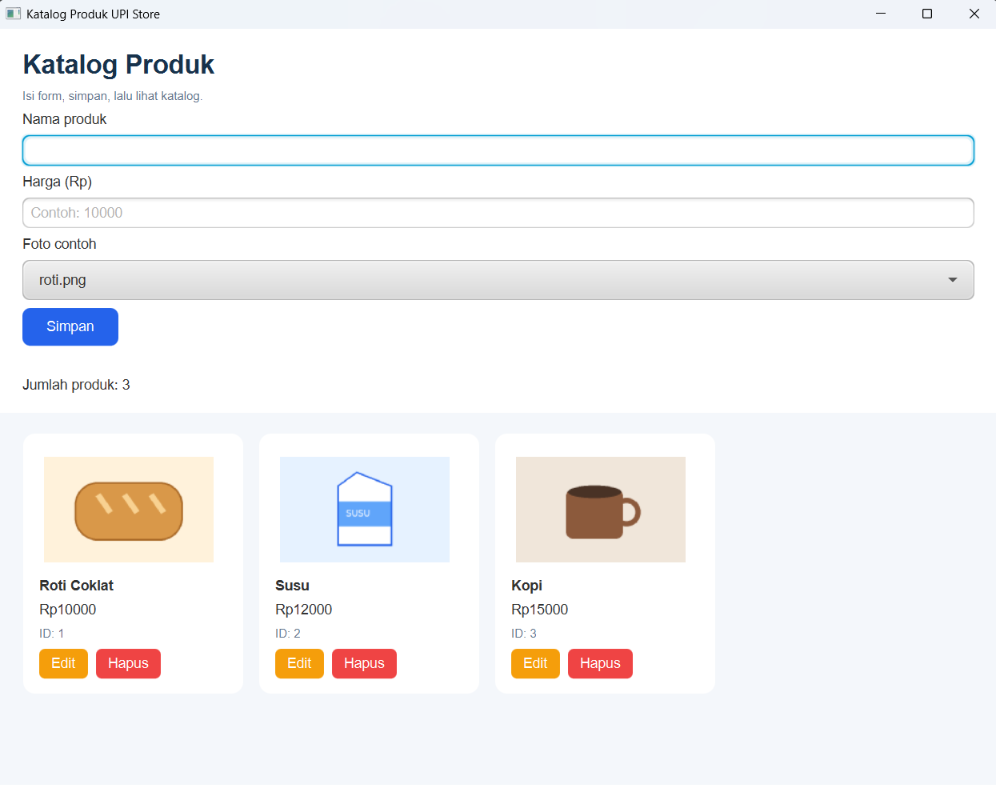

# Katalog Produk - JavaFX & SQLite

Aplikasi desktop Katalog Produk sederhana dengan fitur CRUD (Tambah, Lihat, Edit, dan Hapus) yang dibangun menggunakan Java, Maven, JavaFX (SceneBuilder), dan database SQLite.

## Screenshot Aplikasi
[Screenshot Katalog Produk]




## Persyaratan Sistem
* Java Development Kit (JDK) 21
* Apache Maven
* Apache NetBeans (untuk mode pengembangan)

## Cara Menjalankan Aplikasi

**Melalui Terminal / Command Prompt:**
1. Buka terminal dan arahkan direktori ke folder project ini (`KatalogProduk`).
2. Jalankan perintah berikut:
   ```bash
   mvn clean javafx:run
   ```
